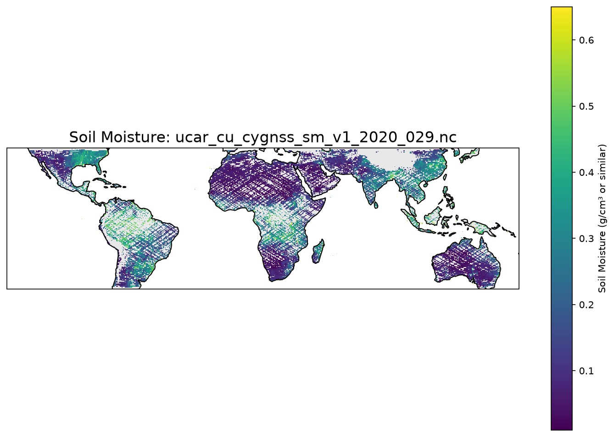

# Fission Plot Example - A Complete Guide

This guide explains how to build, deploy, and use a Fission function that generates soil moisture plots from CYGNSS satellite data. The function downloads compressed NetCDF files, processes them, and returns a visualization as a PNG image.

## Table of Contents

- [Overview](#overview)
- [What is Fission?](#what-is-fission)
- [What This Function Does](#what-this-function-does)
- [Architecture](#architecture)
- [Prerequisites](#prerequisites)
- [Directory Structure](#directory-structure)
- [Building the Container](#building-the-container)
- [Deployment Steps](#deployment-steps)
- [Using the Function](#using-the-function)
- [Understanding the Code](#understanding-the-code)
- [Troubleshooting](#troubleshooting)
- [Clean Up](#clean-up)

---

## Overview

This example demonstrates a Fission Function-as-a-Service deployment that:

1. Accepts a URL to a compressed NetCDF (.nc.gz) file via HTTP request
2. Downloads and decompresses the file
3. Reads soil moisture data using xarray
4. Creates a cartographic visualization with Mercator projection
5. Returns a PNG image as the HTTP response

---

## What is Fission?

Fission is a serverless framework for Kubernetes that makes it easy to build and deploy serverless functions. Think of it as "Functions as a Service" (FaaS) for Kubernetes.

### Key Concepts

| Concept | Description |
|---------|-------------|
| **Function** | Your code that does the actual work (e.g., `plot_cygnss_sm`) |
| **Environment** | A container image with the runtime and dependencies for your function |
| **Package** | Your function code packaged with metadata |
| **Route** | An HTTP endpoint that triggers your function |
| **Pool Manager** | The component that manages function instances (reusing containers for efficiency) |

---

## What This Function Does

The `plot_cygnss_sm` function:

1. **Receives input** via HTTP query parameter `fileurl`
2. **Downloads** a .nc.gz file from the provided URL
3. **Decompresses** the gzip file to get the NetCDF data
4. **Extracts** soil moisture data and coordinates
5. **Plots** the data on a Mercator projection map
6. **Returns** a PNG image with the plot



---

## Architecture

```
┌─────────────────────────────────────────────────────────────────┐
│                         Kubernetes Cluster                      │
│                                                                 │
│  ┌──────────────────────────────────────────────────────────┐   │
│  │                    Fission Router                        │   │
│  │  ┌────────────────────────────────────────────────────┐  │   │
│  │  │  Route: /plot-example                             │  │   │
│  │  │  Triggers: plot-example function                  │  │   │
│  │  └────────────────────────────────────────────────────┘  │   │
│  └──────────────────────────────────────────────────────────┘   │
│                              │                                   │
│                              ▼                                   │
│  ┌──────────────────────────────────────────────────────────┐   │
│  │              Fission Pool Manager                        │   │
│  │  ┌────────────────────────────────────────────────────┐  │   │
│  │  │  Container Pool (poolsize: 1)                     │  │   │
│  │  │  ┌────────────────────────────────────────────┐   │  │   │
│  │  │  │  plot-example Function                     │   │  │   │
│  │  │  │  - Loads sm.py                             │   │  │   │
│  │  │  │  - Runs plot_cygnss_sm()                   │   │  │   │
│  │  │  └────────────────────────────────────────────┘   │  │   │
│  │  └────────────────────────────────────────────────────┘  │   │
│  └──────────────────────────────────────────────────────────┘   │
│                              │                                   │
│                              ▼                                   │
│  ┌──────────────────────────────────────────────────────────┐   │
│  │                  External Services                       │   │
│  │  - Download .nc.gz files from URLs                       │   │
│  │  - Return PNG images to clients                          │   │
│  └──────────────────────────────────────────────────────────┘   │
└─────────────────────────────────────────────────────────────────┘
```

---

## Prerequisites

Before deploying this function, you need:

1. **A Kubernetes cluster** with Fission installed
   - Fission version: 1.27777777+ recommended
   - Traefik gateway configured for routing

2. **Fission CLI** installed locally
   ```bash
   # Download fission CLI
   curl -fsSL https://fission.io/download.sh | bash
   ```

3. **Docker** installed (for building the container image)

4. **Access to a container registry** to push your built image
   - Example: `hub.k8s.ucar.edu/khrpcek/fission-plot-example:3.13`

5. **kubectl** configured to access your cluster

---

## Directory Structure

```
plot/
├── README.md              # Quick start commands
├── sm.py                  # Main function code
├── container/             # Container build files
│   ├── Containerfile      # Dockerfile for building the environment
│   ├── environment.yaml   # Conda environment with dependencies
│   ├── requirements.txt   # PyPI packages
│   ├── server.py          # Fission runtime server
│   └── flask_sockets.py   # WebSocket support
├── fission-objects/       # Fission resource definitions
│   ├── env.yaml           # Environment definition
│   └── pkg.yaml           # Function package definition
└── specs/                 # Kubernetes-style YAML manifests
    ├── fission-deployment-config.yaml
    ├── function-plot-example.yaml
    └── README
```

### File Descriptions

| File | Purpose |
|------|---------|
| `sm.py` | The main function code that processes data and creates plots |
| `container/Containerfile` | Defines the Docker image with Python and dependencies |
| `container/environment.yaml` | Conda environment specification for scientific libraries |
| `container/requirements.txt` | PyPI packages required by the function |
| `fission-objects/env.yaml` | Fission Environment custom resource definition |
| `fission-objects/pkg.yaml` | Fission Package and Function definitions |

---

## Building the Container

The container image contains Python 3, scientific libraries (xarray, matplotlib, cartopy), and the Fission runtime. Instead of building you can use the image already hosted at hub.k8s.ucar.edu/khrpcek/fission-plot-example:3.13.

### Step 1: Build the Docker Image

```bash
cd /home/khrpcek/fission/examples/plot
docker build -t hub.k8s.ucar.edu/khrpcek/fission-plot-example:3.13 -f container/Containerfile .
```

### Step 2: Push to Container Registry

```bash
docker push hub.k8s.ucar.edu/khrpcek/fission-plot-example:3.13
```

### Understanding the Containerfile

The `Containerfile` does the following:

1. Uses `continuumio/miniconda3:latest` as the base image
2. Installs system dependencies (gcc, build-essential, zip, etc.)
3. Copies `requirements.txt` and `environment.yaml`
4. Installs PyPI packages via pip
5. Updates Conda environment with scientific libraries
6. Copies Python files into the container
7. Sets the entrypoint to Python

```dockerfile
FROM continuumio/miniconda3:latest

WORKDIR /app

RUN apt update && apt install -y gcc build-essential zip libev-dev libffi-dev bash && \
    rm -rf /var/lib/apt/lists/*

COPY requirements.txt environment.yaml /app
RUN pip3 install -r requirements.txt --no-cache-dir
RUN conda env update --solver=libmamba -f environment.yaml

COPY *.py /app/
ENV PYTHONUNBUFFERED=1
ENTRYPOINT ["python3"]
CMD ["server.py"]
```

### Dependencies

**Conda packages (environment.yaml):**
- `xarray` - NetCDF data handling
- `numpy` - Numerical operations
- `netCDF4` - NetCDF file format support
- `h5netcdf` - HDF5/NetCDF support
- `matplotlib` - Plotting
- `cartopy` - Geographic projections
- `openblas` - Optimized BLAS library
- `freetype` - Font rendering for matplotlib

**PyPI packages (requirements.txt):**
- `bjoern` - High-performance WSGI server
- `blinker` - Signal dispatching
- `Flask` - Web framework
- `gevent` - Async networking
- `requests` - HTTP client
- `sentry-sdk` - Error tracking

---

## Deployment Steps

### Option 1: Manual Deployment (Step by Step)

This option shows each command individually, which is helpful for understanding what happens and for debugging.

#### Step 1: Create the Environment

```bash
fission env create \
  --name plot-example \
  --image hub.k8s.ucar.edu/khrpcek/fission-plot-example:3.13 \
  --builder hub.k8s.ucar.edu/khrpcek/fission-plot-example:3.13 \
  --poolsize 1
```

**Parameters:**
- `--name`: Name of the environment
- `--image`: Runtime container image
- `--builder`: Builder container image (same as runtime for pre-built images)
- `--poolsize`: Number of function instances to keep warm (1 in this case)

#### Step 2: Create the Function

```bash
fission function create \
  --name plot-example \
  --env plot-example \
  --entrypoint plot_cygnss_sm \
  --code sm.py
```

**Parameters:**
- `--name`: Name of the function
- `--env`: Environment to use
- `--entrypoint`: Function name to call (`plot_cygnss_sm` in `sm.py`)
- `--code`: Source code file

#### Step 3: Create the Route

```bash
fission route create \
  --function plot-example \
  --route-provider gateway \
  --name plot-example \
  --route-path='/plot-example' \
  --route-host fn.k8s.ucar.edu \
  --url /plot-example \
  --gateway traefik/traefik-gateway
```

**Parameters:**
- `--function`: Which function to trigger
- `--route-provider`: Gateway provider (gateway or router)
- `--route-path`: URL path for the route
- `--route-host`: Hostname for the route
- `--gateway`: Gateway resource to use

### Option 2: Using fission spec (GitOps)

This option uses Fission's spec system for GitOps-style deployments.

#### Step 1: Generate specs from existing resources

If you have the function already deployed:

```bash
fission function get --name plot-example --spec
fission env get --name plot-example --spec
```

#### Step 2: Apply specs

```bash
cd /home/khrpcek/fission/examples/plot/specs
fission spec apply
```

This will:
1. Upload the `sm.py` file as an archive
2. Create/update the Environment
3. Create/update the Function
4. Create/update the Route

---

## Using the Function

Once deployed, you can call the function via HTTP:

### Basic Usage

```bash
curl "https://fn.k8s.ucar.edu/plot-example?fileurl=https://data.cosmic.ucar.edu/gnss-r/soilMoisture/cygnss/level3/2020/029/ucar_cu_cygnss_sm_v1_2020_029.nc.gz"
```

Compatible Cygnss gnss-r data is hosted at https://data.cosmic.ucar.edu/gnss-r/soilMoisture/cygnss/level3. Generally any available file will work with this function.

The function will:
1. Read the `fileurl` query parameter
2. Download and process the file
3. Return the PNG image

### With HTTP Headers (Alternative)

You can also pass the URL via the `X-Fission-Params-fileurl` header:

```bash
curl \
  -H "X-Fission-Params-fileurl: https://example.com/data/soil_moisture.nc.gz" \
  "https://fn.k8s.ucar.edu/plot-example" \
  --output soil_moisture.png
```

### Saving the Output

To save the returned image directly to a file:

```bash
curl "https://fn.k8s.ucar.edu/plot-example?fileurl=https://example.com/data/soil_moisture.nc.gz" --output plot.png
```

### Testing with a Sample URL

```bash
# Test with a sample NetCDF file URL
curl "https://fn.k8s.ucar.edu/plot-example?fileurl=https://data.example.gov/cygnss/sm_daily_2024.nc.gz" --output plot.png

# View the result
open plot.png  # macOS
xdg-open plot.png  # Linux
```

---

## Understanding the Code

### sm.py - Main Function

```python
import requests
import io
import gzip
import os
import shutil
import logging
import xarray as xr
import matplotlib.ft2font
import matplotlib.pyplot as plt
import cartopy.crs as ccrs
import cartopy.feature as cfeature
from urllib.parse import urlparse, parse_qs
from flask import request, make_response
```

**Imports:**
- `requests` - For downloading files from URLs
- `io`, `gzip`, `shutil` - For file handling and compression
- `xarray` - For reading NetCDF files
- `matplotlib`, `cartopy` - For plotting with geographic projections
- `flask` - For HTTP request/response handling

### The `plot_cygnss_sm()` Function

#### Step 1: Extract URL from Request

```python
def plot_cygnss_sm():
    try:
        file_url = parse_qs(request.query_string.decode('utf-8'))['fileurl']
        if isinstance(file_url, list):
            file_url = file_url[0]
        logging.info(f"Processing URL from header: {file_url}")
    except KeyError:
        logging.error("X-Fission-Params-fileurl header not found.")
        return "Error: Missing file URL header."
    except Exception as e:
        logging.error(f"Error accessing HTTP headers: {e}")
        return "Error: Internal environment error."
```

The function reads the `fileurl` parameter from the query string. Fission passes HTTP headers as query parameters when using the gateway router.

#### Step 2: Download and Decompress

```python
filename = file_url.split('/')[-1]
base_name = filename.replace('.gz', '')

temp_gz_filename = '/tmp/plot_input.nc.gz'
temp_nc_filename = '/tmp/plot_input.nc'

# Download the file
with requests.get(file_url, stream=True) as r:
    r.raise_for_status()
    with open(temp_gz_filename, 'wb') as f:
        shutil.copyfileobj(r.raw, f)

# Decompress
with gzip.open(temp_gz_filename, 'rb') as f_in:
    with open(temp_nc_filename, 'wb') as f_out:
        f_out.write(f_in.read())

# Cleanup
os.remove(temp_gz_filename)
```

The file is downloaded to `/tmp/` (Fission containers provide `/tmp` for temporary storage), then decompressed.

#### Step 3: Load and Process Data

```python
ds = xr.open_dataset(temp_nc_filename)
sm_data = ds['SM_daily']
lon_data = ds['longitude']
lat_data = ds['latitude']
```

Xarray opens the NetCDF file and extracts the soil moisture data and coordinates.

#### Step 4: Create the Plot

```python
fig = plt.figure(figsize=(12, 8))
ax = plt.axes(projection=ccrs.Mercator())

im = ax.pcolormesh(
    lon_data, 
    lat_data, 
    sm_data, 
    shading='auto', 
    cmap='viridis', 
    transform=ccrs.PlateCarree()
)

# Add map features
ax.add_feature(cfeature.COASTLINE)
ax.add_feature(cfeature.LAND, facecolor='lightgray', alpha=0.5)
ax.add_feature(cfeature.OCEAN, facecolor='white')

plt.colorbar(im, ax=ax, label='Soil Moisture (g/cm³ or similar)')
plt.title(f'Soil Moisture: {base_name}', fontsize=16)
```

The plot uses:
- **Mercator projection** for the map
- **viridis colormap** for soil moisture values
- **Coastline, land, and ocean features** for geographic context

#### Step 5: Return as PNG

```python
buf = io.BytesIO()
plt.savefig(buf, format='png', dpi=150, bbox_inches='tight')
plt.close(fig)

response = make_response(buf.getvalue())
response.headers.set('Content-Type', 'image/png')
response.headers.set('Content-Disposition', 'inline', filename='image.png')
return response
```

The plot is saved to an in-memory buffer, then returned as a PNG image response.

---

## Troubleshooting

### Common Issues

#### 1. Function Returns "Error: Missing file URL header"

**Cause:** The `fileurl` parameter wasn't passed correctly.

**Solution:** Ensure you're using the correct URL format:
```bash
curl "https://fn.k8s.ucar.edu/plot-example?fileurl=https://data.cosmic.ucar.edu/gnss-r/soilMoisture/cygnss/level3/2020/029/ucar_cu_cygnss_sm_v1_2020_029.nc.gz"
```

#### 2. Container Pull Backoff / ImagePullBackOff

**Cause:** Kubernetes can't pull the container image.

**Solution:**
```bash
# Verify image exists
docker pull hub.k8s.ucar.edu/khrpcek/fission-plot-example:3.13

# Check registry credentials
kubectl get secrets -n fission-function
```

#### 3. Function Timeout

**Cause:** The function takes too long to process large files.

**Solution:** Increase the function timeout:
```bash
fission function update --name plot-example --timeout 120
```

#### 4. Missing Dependencies

**Cause:** A required Python package isn't in the container.

**Solution:** Add to `container/environment.yaml` or `container/requirements.txt` and rebuild.

#### 5. Memory Issues

**Cause:** Processing large NetCDF files requires more memory.

**Solution:** Increase container resources in the Environment spec.

---

## Clean Up

### Remove Function and Environment

```bash
# Delete the function
fission function delete --name plot-example

# Delete the environment
fission env delete --name plot-example
```

### Using fission spec

```bash
cd /home/khrpcek/fission/examples/plot/specs
fission spec apply --delete
```

### Remove Container Image

```bash
# Local image
docker rmi hub.k8s.ucar.edu/khrpcek/fission-plot-example:3.13

# Remote image (if registry supports)
# Use your registry's deletion mechanism
```

---

## Next Steps

### Enhancements You Could Add

1. **Error Handling for Bad Data:** Check for valid NetCDF variables before plotting
2. **Configurable Output:** Allow users to specify output format (PNG, JPEG, SVG)
3. **Caching:** Cache downloaded files to avoid re-downloading
4. **Authentication:** Support authenticated URLs with Bearer tokens
5. **Multiple Variables:** Allow users to specify which variable to plot

### Learning Resources

- [Fission Documentation](https://fission.io/docs/)
- [xarray Documentation](https://xarray.dev/)
- [Cartopy Documentation](https://scitools.org.uk/cartopy/docs/latest/)
- [Matplotlib Gallery](https://matplotlib.org/stable/gallery/index.html)

---

